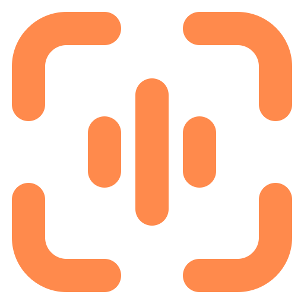

# ScreenVoicer

**ScreenVoicer** — легка програма для Windows, що живе в системному треї: робить знімок екрана, дає швидко його розмітити, записує голосовий коментар (розпізнається **офлайн** через Whisper) і копіює в буфер обміну готовий Markdown для баг-репорту чи AI-асистента.

```markdown
[C:\AI_Screenshots\screenshot_20261009_141611_139.png]
**Comment:** Кнопка «Зберегти» не реагує, якщо змінити email і одразу натиснути Enter.
```

---

## 🚀 Можливості

- **Гаряча клавіша** (типово `Alt + Shift + S`, змінюється в треї: натиснув комбінацію — і готово, зайняті програма відхиляє) — миттєвий знімок монітора під курсором у рідній роздільності (коректно працює з різним масштабом на кількох моніторах).
- **Виділення області** із затемненням усього навколо та розміром у пікселях; повторне перетягування поза областю — нове виділення. Або режим «Весь екран».
- **Розмітка:** олівець, маркер, стрілка, рамка, **текстові підписи** (кольорова плашка, читається на будь-якому фоні; подвійний клік — редагувати, перетягування — перемістити) і **нумеровані мітки 1-2-3** (зручно пояснювати голосом по пунктах), гумка; 6 кольорів, 3 розміри; `Ctrl+Z` / `Ctrl+Y` для всього, включно з переміщенням і правками тексту.
- **Голос:** затисніть `Пробіл` і говоріть, **або** коротко натисніть `Пробіл` / клацніть мікрофон — запис іде, доки не натиснете ще раз. Працює і коли курсор у полі коментаря (короткий `Пробіл` друкує пробіл, утримання — записує). Текст з'являється наживо, після зупинки уточнюється; кілька фрагментів дописуються один за одним, ручні правки не губляться.
- **Одна компактна панель** згори: режим, інструменти й палітра (розкриваються при наведенні), мікрофон, поле коментаря, зберегти — на «склі» з розмиттям; панель сама переїжджає вниз, якщо виділена область під нею.
- **Офлайн-розпізнавання (Whisper.net)** на **відеокарті** (Vulkan: NVIDIA / AMD / Intel) або процесорі, три моделі на вибір у треї — перемикаються без перезапуску, нова завантажується з прогресом, поки працює стара. Мова: українська / English / автовизначення.
- **`Enter`** — вікно зникає одразу, PNG зберігається у фоні, у буфер потрапляють Markdown, сам файл і картинка (вставляється і в термінал, і в Slack/Telegram/браузер).
- **Галерея** — пошук по коментарях, копіювання, перетягування знімка мишкою прямо в чат, видалення.
- **Скляне меню трею** (лівий або правий клік по іконці): знімок, знімок із затримкою 3/5/10 с, галерея, мікрофон із прослуховуванням запису, мова в один клік, модель розпізнавання, відеокарта й CUDA, гаряча клавіша, автозапуск і стан голосу. Подвійний клік по іконці одразу робить знімок.
- **Таймер у панелі знімка і в галереї**: кнопка з годинником → 3, 5 або 10 с. Вікно ховається, іде відлік, і екран знімається заново, тож встигнете відкрити меню чи навести мишу на підказку.

### 🧠 Моделі розпізнавання

Час на фразу 4–7 с (GeForce GTX 1650 / Core i5-10400F):

| Модель | Розмір | Відеокарта (CUDA / Vulkan) | Процесор | Коли обирати |
| :--- | ---: | ---: | ---: | :--- |
| Швидка — `base` | 141 МБ | 0,3 с | 1,3 с | слабкий ПК без відеокарти |
| Точна — `small` | 181 МБ | 0,7 с | 4,2 с | слабша відеокарта або потрібна швидкість |
| Дуже точна — `turbo` | 547 МБ | 2,8 / 3,3 с | дуже повільно | відеокарта AMD / Intel (large-v3-turbo) |
| Максимальна — `large` | 1031 МБ | **3,5** / 8 с | дуже повільно | **рекомендовано з NVIDIA + CUDA**: найкраще розуміє нечітку вимову (large-v3) |

На записі з нечіткою вимовою `large` розпізнав фразу без помилок, `turbo` помилився в одному слові, `small` — майже в кожному.

**Прискорення NVIDIA CUDA** (трей → «Модель розпізнавання» → «Прискорення NVIDIA CUDA»): одноразове завантаження ~590 МБ. Це збірка Whisper.net з CUDA (NuGet) і бібліотеки NVIDIA cuBLAS / CUDA Runtime з офіційних пакетів NVIDIA; кожен файл звіряється з SHA-256. На диску займає ~1 ГБ у `%LOCALAPPDATA%\ScreenVoicer\cuda`, а щоб видалити — достатньо видалити цю папку. Без CUDA відеокарта працює через Vulkan. Якщо CUDA не запускається, програма сама переходить на Vulkan, а далі на процесор. Без інтерфейсу пакет встановлюється командою `ScreenVoicer.exe --install-cuda`.

Перший запуск через Vulkan компілює шейдери (~25 с, один раз): у цей час розпізнавання вже працює на процесорі, а потім само переходить на відеокарту. Якщо драйвер відеокарти колись «впаде», програма помітить це під час наступного запуску і перемкнеться на процесор.

## ⌨️ Клавіші у вікні знімка

| Клавіша | Дія |
| :--- | :--- |
| `Alt + Shift + S` (або ваша) | Зробити знімок (глобально) |
| Миша | Виділити область |
| Затиснути `Пробіл` | Голосовий коментар, поки тримаєте |
| Коротко `Пробіл` або клік по мікрофону | Почати / зупинити запис без утримання |
| `Enter` | Зберегти PNG і скопіювати Markdown (у текстовому підписі — завершити підпис) |
| `Shift + Enter` | Новий рядок у коментарі чи підписі |
| `Esc` | Скасувати (під час запису — викинути цей фрагмент; у полі коментаря чи підписі — вийти з поля) |
| `P` `H` `A` `R` `T` `N` `E` | Олівець, маркер, стрілка, рамка, текст, мітка 1-2-3, гумка |
| `1`–`6`, `[` `]` | Колір, товщина / розмір тексту й міток |
| `Ctrl + Z` / `Ctrl + Y` | Скасувати / повторити |
| `Shift` під час малювання | Стрілка під кутом 45°, рамка-квадрат |
| Гумкою по підпису чи мітці | Видалити його |

## 🩺 Якщо щось не працює

- **Голос не розпізнається / «повна тиша»** — у треї → «Мікрофон» оберіть справжній мікрофон. Системний мікрофон за замовчуванням іноді віртуальний (наприклад, `Steam Streaming`) і передає лише тишу.
- **Розпізнає «абракадабру» / «Мікрофон звучить глухо»** — програма сама міряє, чи доходять до неї високі частоти голосу (приголосні). Послухайте себе: ▾ біля мікрофона (або трей → «Мікрофон») → «Прослухати останній запис». Якщо звучить глухо, «як через подушку» або дуже тихо, жодна модель цього не розбере, тож перевірте підключення. Найчастіша причина: гарнітура від телефона з **одним штекером на 4 контакти**, вставлена в рожеве гніздо ПК. Тоді комп'ютер записує динамік навушника, а не мікрофон. Потрібен перехідник-розгалужувач (1×4-pin → 2×3-pin) або USB-мікрофон/гарнітура. Також допомагає тримати мікрофон ближче до рота.
- **Журнал:** `%LOCALAPPDATA%\ScreenVoicer\logs\screenvoicer.log`.
- **Розпізнавання повільне** — у треї → «Модель розпізнавання» перевірте, що увімкнено «Використовувати відеокарту» і в статусі видно назву відеокарти. Без відеокарти оберіть «Швидка — base».
- **Самоперевірка збірки:** `ScreenVoicer.exe --selftest [--model large] [--cpu] [--lang en] speech.wav` (WAV 16 кГц, моно) — завантажує модель так само, як програма, і друкує, де вона працює, результат і час розпізнавання.
- Дані: налаштування, історія і модель — у `%APPDATA%\ScreenVoicer\`, скриншоти — у `C:\AI_Screenshots\` (або `Зображення\AI_Screenshots`, якщо в корінь диска писати не можна).

## 🎨 Бренд «Tally»

Знак програми — помаранчева плитка, що світиться, як лампа «запис» на камері, з темними кутами кадру й білою капсулою мікрофона. Це один малюнок для всіх розмірів, від трею (16 px) до іконки програми. Уся програма в темному склі з одним теплим акцентом:

| Роль | Колір |
| :--- | :--- |
| Акцент (лампа, «Зберегти», активні елементи) | `#FF8A4C` → `#FFC68A` |
| Тло вікон / поверхні | `#0F0F13` / `#17171D` |
| Текст / другорядний текст | `#F3F3F6` / `#9D9DAA` |
| Запис голосу | `#FF4D5E` |

- **Скло**: активна кнопка — легкий теплий відтінок, відблиск згори вниз і світлий обідок. Головна дія — помаранчеве скло зі світінням, запис — червоне. Усі токени й стилі лежать в `App.xaml`.
- **Іконки**: власний лінійний набір (сітка 24, круглі закінчення, та сама геометрія, що й кути знака). Це геометрії `Icon.*` в `App.xaml`, малює їх `Views/GlyphIcon`.
- **Лого** — векторне (`BrandMark` в `App.xaml`). Файли `Resources/AppIcon.ico` (16–256 px) і `AppLogo.png` згенеровані з нього. Для сайту й соцмереж є `branding/logo.svg` і `logo-512.png`, а дошка напрямів бренду — у `branding/brand-board.html`.
- **Лендінг** — `landing/index.html` разом із картинками в `landing/img`. Це статична сторінка, її можна викласти на будь-який хостинг (GitHub Pages, Netlify). Кнопка «Завантажити» поки має позначку «скоро»; щоб її увімкнути, замініть `aria-disabled` на справжнє посилання на інсталятор.

## 🛠️ Структура

```
ScreenVoicer/
├── App.xaml(.cs)              # трей, один екземпляр, автозапуск, глобальні помилки; бренд: кольори, скло, іконки, лого
├── app.manifest               # Per-Monitor V2 DPI, сучасні системні діалоги
├── Native/User32.cs           # гаряча клавіша, позиціювання/активація вікон, DWM
├── Services/
│   ├── ScreenCaptureService   # знімок монітора під курсором
│   ├── AudioRecorderService   # запис 16 кГц моно (WinMM), вибір мікрофона за назвою
│   ├── WhisperTranscriptionService  # моделі, CPU→GPU (CUDA / Vulkan), перемикання без перерви, превʼю/фінал
│   ├── CudaPack               # необовʼязкове прискорення NVIDIA CUDA (завантаження з перевіркою SHA-256)
│   ├── WhisperModels          # каталог моделей (base / small / turbo / large)
│   ├── SpeechTextUtils        # детектор тиші, доповнення коротких фраз, фільтр «галюцинацій»
│   ├── ImageCompositorService # шар анотацій у рідній роздільності, кроп, PNG
│   ├── ClipboardService       # Markdown + файл + картинка в буфер
│   ├── HistoryService         # history.json (атомарний запис, резервна копія при пошкодженні)
│   ├── NotificationService    # стек сповіщень
│   ├── HotkeyService, HotkeyGesture  # глобальна гаряча клавіша та її розбір/показ
│   ├── SettingsService, StartupManager, Log, SelfTest
└── Views/
    ├── OverlayWindow          # вікно знімка: виділення, розмітка, текст, мітки, голос
    ├── GalleryWindow          # галерея
    ├── HotkeyWindow           # «натисніть нову комбінацію»
    ├── TrayMenuWindow         # скляне меню трею
    ├── ToastWindow, CountdownWindow
    └── GlyphIcon              # лінійні іконки бренду
branding/                      # лого (SVG/PNG), дошка напрямів бренду
landing/                       # статичний лендінг
```

## 📦 Збірка

```powershell
dotnet build
dotnet run
```

Один самодостатній `.exe` (без встановленого .NET):

```powershell
dotnet publish -c Release -o ./publish
```

Інсталятор: відкрийте `installer.iss` в Inno Setup 6 і зберіть — він додає автозапуск з ключем `--autostart` (без відкриття галереї при вході в систему).
